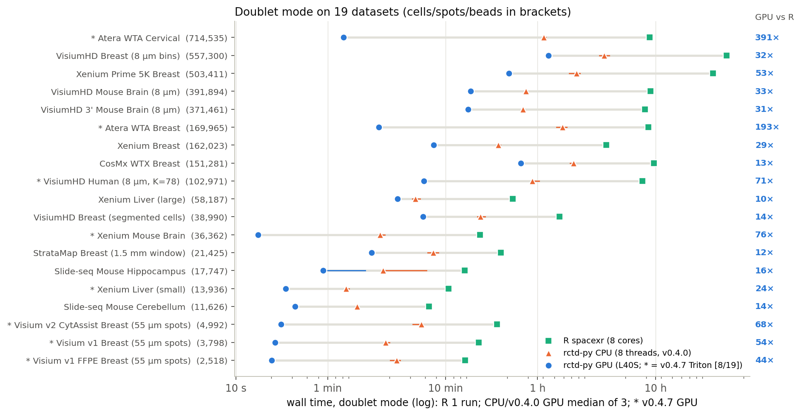
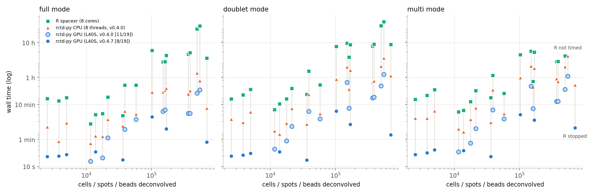

# Benchmarks

rctd-py against R spacexr on 19 datasets from eight platforms (Xenium, Xenium Prime 5K, CosMx,
Atera, Visium v1, v1 FFPE and v2 CytAssist, Visium HD probe-based and 3', Slide-seq and StrataMap),
from 2,518 to 714,535 cells, spots or beads, each run in all three modes.

On one GPU, rctd-py is 10-391x faster than R in doublet mode (median 32x across all 19 datasets; 24-391x, median 70x on the 8 datasets re-measured with v0.4.7), 10-260x in full mode and 5-89x in multi mode. On 8 CPU threads, without a GPU, it is 3.7-14x faster than R in doublet mode (v0.4.0).

## Setup

- **rctd-py GPU**: one NVIDIA L40S (48 GB). **rctd-py CPU**: `device="cpu"`, 8 threads on an AMD
  EPYC 9554. Both use `dtype="float64"`, `batch_size=10000` and `UMI_min=20`.
- **R spacexr** 2.2.1 on R 4.5.0, `max_cores = 8`, `UMI_min = 20`, on the same EPYC 9554 nodes.
- **Timed scope**: everything after the data is loaded. For rctd-py that is
  {class}`~rctd.Reference` plus {func}`~rctd.run_rctd`, sigma estimation included; for R,
  `Reference()`, `SpatialRNA()`, `create.RCTD()` and `run.RCTD()`.
- **Runs**: for the v0.4.0 baseline, an untimed warm-up on 2,000 cells fills the `torch.compile`
  cache, then rctd-py runs three times and the tables give the median. The 8 datasets marked
  `(v0.4.7)` (and `*` in the doublet figure) were re-measured as a single L40S GPU run on
  `rctd-py 0.4.7` (`float64`, `batch_size=10000`, `UMI_min=20`) with fused Triton GPU kernels
  enabled by default. R ran once per dataset and mode.
- **Cells** are the pixels fitted: those with at least 20 UMIs, the same filter on both sides.
- **Version**: the 11 datasets without `(v0.4.7)` retain their v0.4.0 baseline GPU timings (their
  intermediate benchmark inputs were removed from scratch storage after v0.4.0; specifically, the
  pre-0.4.0 October 2026 run or v0.4.0 for the last four datasets added), and all CPU and R spacexr
  timings across all 19 datasets are unchanged from that v0.4.0 benchmark. CPU performance itself
  was also accelerated later in v0.4.5 and v0.4.6.

## Runtime

| Dataset | Platform | Cells | Genes | K | Mode | R spacexr | rctd-py CPU | rctd-py GPU | GPU vs R |
|---|---|---:|---:|---:|---|---:|---:|---:|---:|
| Visium v1 FFPE Breast (55 µm spots) (v0.4.7) | Visium v1 FFPE | 2,518 | 16,781 | 40 | full | 14.8 min | 2.3 min | 19 s | 45x |
| | | | | | doublet | 14.5 min | 3.8 min | 20 s | 44x |
| | | | | | multi | 14.2 min | 4.1 min | 22 s | 39x |
| Visium v1 Breast (55 µm spots) (v0.4.7) | Visium v1 | 3,798 | 17,628 | 40 | full | 12.8 min | 53 s | 20 s | 38x |
| | | | | | doublet | 19.1 min | 3.1 min | 21 s | 54x |
| | | | | | multi | 18.5 min | 4.1 min | 25 s | 45x |
| Visium v2 CytAssist Breast (55 µm spots) (v0.4.7) | Visium v2 CytAssist | 4,992 | 17,215 | 40 | full | 15.9 min | 3.0 min | 22 s | 43x |
| | | | | | doublet | 27.3 min | 6.2 min | 24 s | 68x |
| | | | | | multi | 26.9 min | 6.7 min | 30 s | 54x |
| Slide-seq Mouse Cerebellum | Slide-seq V2 | 11,626 | 19,915 | 19 | full | 2.8 min | 46 s | 14 s | 12x |
| | | | | | doublet | 7.2 min | 1.8 min | 32 s | 14x |
| | | | | | multi | 6.2 min | 2.0 min | 27 s | 14x |
| Xenium Liver (small) (v0.4.7) | Xenium (custom panel) | 13,936 | 376 | 45 | full | 5.1 min | 76 s | 26 s | 12x |
| | | | | | doublet | 10.6 min | 86 s | 26 s | 24x |
| | | | | | multi | 6.9 min | 1.7 min | 29 s | 14x |
| Slide-seq Mouse Hippocampus | Slide-seq V2 | 17,747 | 22,594 | 17 | full | 5.5 min | 73 s | 18 s | 18x |
| | | | | | doublet | 14.5 min | 3.0 min | 55 s | 16x |
| | | | | | multi | 12.2 min | 3.8 min | 47 s | 16x |
| StrataMap Breast (1.5 mm window) | Illumina StrataMap | 21,425 | 16,016 | 40 | full | 16.4 min | 3.8 min | 67 s | 15x |
| | | | | | doublet | 29.4 min | 7.8 min | 2.4 min | 12x |
| | | | | | multi | 25.1 min | 8.0 min | 2.1 min | 12x |
| Xenium Mouse Brain (v0.4.7) | Xenium (248-plex) | 36,362 | 242 | 22 | full | 4.9 min | 2.5 min | 16 s | 19x |
| | | | | | doublet | 19.6 min | 2.8 min | 15 s | 76x |
| | | | | | multi | 16.0 min | 3.1 min | 19 s | 50x |
| VisiumHD Breast (segmented cells) | Visium HD | 38,990 | 17,585 | 40 | full | 36.4 min | 6.5 min | 1.9 min | 19x |
| | | | | | doublet | 1.5 h | 19.6 min | 6.4 min | 14x |
| | | | | | multi | 68.9 min | 26.5 min | 7.1 min | 10x |
| Xenium Liver (large) | Xenium (custom panel) | 58,187 | 376 | 45 | full | 36.5 min | 5.3 min | 3.7 min | 10x |
| | | | | | doublet | 37.1 min | 5.5 min | 3.9 min | 10x |
| | | | | | multi | 20.9 min | 5.5 min | 3.9 min | 5x |
| VisiumHD Human (8 µm, K=78) (v0.4.7) | Visium HD | 102,971 | 16,207 | 78 | full | 6.0 h | 22.8 min | 4.5 min | 80x |
| | | | | | doublet | 7.8 h | 54.0 min | 6.5 min | 71x |
| | | | | | multi | 4.5 h | 59.3 min | 5.2 min | 52x |
| CosMx WTX Breast | CosMx (19k WTX) | 151,281 | 17,780 | 40 | full | 2.8 h | 23.5 min | 6.4 min | 26x |
| | | | | | doublet | 9.7 h | 2.0 h | 43.2 min | 13x |
| | | | | | multi | 5.7 h | 2.2 h | 33.9 min | 10x |
| Xenium Breast | Xenium (313-plex) | 162,023 | 304 | 40 | full | 2.9 h | 26.3 min | 7.0 min | 24x |
| | | | | | doublet | 3.8 h | 27.8 min | 7.9 min | 29x |
| | | | | | multi | 46.6 min | 32.4 min | 7.7 min | 6x |
| Atera WTA Breast (v0.4.7) | Atera (18k WTA) | 169,965 | 17,949 | 40 | full | 4.3 h | 29.8 min | 2.0 min | 128x |
| | | | | | doublet | 8.7 h | 1.6 h | 2.7 min | 193x |
| | | | | | multi | 5.3 h | 1.9 h | 3.6 min | 89x |
| VisiumHD 3' Mouse Brain (8 µm) | Visium HD 3' (poly-A) | 371,461 | 19,327 | 22 | full | 4.7 h | 20.3 min | 5.6 min | 50x |
| | | | | | doublet | 8.1 h | 45.0 min | 15.5 min | 31x |
| | | | | | multi | 2.9 h | 55.3 min | 12.3 min | 14x |
| VisiumHD Mouse Brain (8 µm) | Visium HD | 391,894 | 15,331 | 22 | full | 5.1 h | 25.1 min | 5.6 min | 55x |
| | | | | | doublet | 9.0 h | 48.0 min | 16.3 min | 33x |
| | | | | | multi | 2.9 h | 46.6 min | 12.4 min | 14x |
| Xenium Prime 5K Breast | Xenium Prime 5K | 503,411 | 4,929 | 40 | full | 24.6 h | 80.7 min | 21.3 min | 69x |
| | | | | | doublet | 30.7 h | 2.1 h | 34.5 min | 53x |
| | | | | | multi | 4.1 h | 2.1 h | 27.4 min | 9x |
| VisiumHD Breast (8 µm bins) | Visium HD | 557,300 | 17,585 | 40 | full | 30.2 h | 48.5 min | 26.5 min | 68x |
| | | | | | doublet | 40.0 h | 3.7 h | 74.2 min | 32x |
| | | | | | multi | not timed (2) | 4.1 h | 66.2 min | - |
| Atera WTA Cervical (v0.4.7) | Atera (18k WTA) | 714,535 | 17,949 | 7 | full | 3.6 h | 7.9 min | 50 s | 260x |
| | | | | | doublet | 8.9 h | 67.6 min | 82 s | 391x |
| | | | | | multi | stopped (1) | 37.0 min | 2.1 min | - |

The largest gains are on the large datasets: 31-391x in doublet mode on the five above 300,000 cells
(31-53x on the four measured with v0.4.0; 391x on Atera WTA Cervical with v0.4.7), and 71-193x on
VisiumHD Human (K=78) and Atera WTA Breast with v0.4.7. Against rctd-py on v0.4.0 CPU (8 threads),
the GPU lead is 1.4x on Xenium Liver (large, v0.4.0, 376 genes, 45 types) and 1.8x on VisiumHD Breast
(8 µm bins, v0.4.0 multi), 2.9-3.5x on Xenium Liver (small, v0.4.7), 5.1-11.4x on VisiumHD Human
(K=78, v0.4.7), 15-36x on Atera WTA Breast (v0.4.7), and 9.5-50x on Atera WTA Cervical (v0.4.7).

(1) R's multi mode stopped after 3.2 hours with `process_bead_multi: no cell types passed weight
threshold on full mode`: when one pixel has no candidate type, R ends the whole run. rctd-py keeps
that pixel's highest-weight type and finishes (see {doc}`r_spacexr`).

(2) Not timed. R's full and doublet runs on this dataset took 30 and 40 hours.

## Memory

| Dataset | Cells | K | Peak VRAM | Peak RAM (GPU run) | Peak RAM (CPU run) |
|---|---:|---:|---:|---:|---:|
| Visium v1 FFPE Breast (55 µm spots) (v0.4.7) | 2,518 | 40 | 0.6 GiB | 2.7 GiB | 10 GiB |
| Visium v1 Breast (55 µm spots) (v0.4.7) | 3,798 | 40 | 0.8 GiB | 2.9 GiB | 11 GiB |
| Visium v2 CytAssist Breast (55 µm spots) (v0.4.7) | 4,992 | 40 | 1.0 GiB | 3.0 GiB | 11 GiB |
| Slide-seq Mouse Cerebellum | 11,626 | 19 | 7.2 GiB | 6.0 GiB | 8.2 GiB |
| Xenium Liver (small) (v0.4.7) | 13,936 | 45 | 0.7 GiB | 3.6 GiB | 4.6 GiB |
| Slide-seq Mouse Hippocampus | 17,747 | 17 | 7.7 GiB | 6.6 GiB | 8.3 GiB |
| StrataMap Breast (1.5 mm window) | 21,425 | 40 | 9.6 GiB | 8.1 GiB | 12 GiB |
| Xenium Mouse Brain (v0.4.7) | 36,362 | 22 | 0.6 GiB | 2.7 GiB | 4.1 GiB |
| VisiumHD Breast (segmented cells) | 38,990 | 40 | 11 GiB | 13 GiB | 14 GiB |
| Xenium Liver (large) | 58,187 | 45 | 5.3 GiB | 5.1 GiB | 4.9 GiB |
| VisiumHD Human (8 µm, K=78) (v0.4.7) | 102,971 | 78 | 7.8 GiB | 9.8 GiB | 25 GiB |
| CosMx WTX Breast | 151,281 | 40 | 15 GiB | 40 GiB | 40 GiB |
| Xenium Breast | 162,023 | 40 | 5.6 GiB | 4.6 GiB | 12 GiB |
| Atera WTA Breast (v0.4.7) | 169,965 | 40 | 15 GiB | 15 GiB | 45 GiB |
| VisiumHD 3' Mouse Brain (8 µm) | 371,461 | 22 | 14 GiB | 67 GiB | 68 GiB |
| VisiumHD Mouse Brain (8 µm) | 391,894 | 22 | 14 GiB | 64 GiB | 64 GiB |
| Xenium Prime 5K Breast | 503,411 | 40 | 13 GiB | 41 GiB | 42 GiB |
| VisiumHD Breast (8 µm bins) | 557,300 | 40 | 29 GiB | 134 GiB | 136 GiB |
| Atera WTA Cervical (v0.4.7) | 714,535 | 7 | 23 GiB | 22 GiB | 113 GiB |

Peak VRAM is the most PyTorch allocated in any of the three runs, over all modes. With
`batch_size` fixed it depends mostly on the genes and cell types, but it still rises with the
number of pixels on large whole-transcriptome datasets. On small panels and moderate spot counts
with v0.4.7, peak VRAM stays at 0.6-1.0 GiB (Visium v1/v2, Xenium small/brain) and 7.8 GiB on
VisiumHD Human (103k bins, K=78, `float64`, `batch_size=10000`). On `Atera WTA Cervical` (714k
cells), v0.4.7's slabbed pairwise Triton scoring temporarily peaks at 23 GiB at `batch_size=10000`
before dropping host RAM to 22 GiB. Lower `batch_size` to reduce VRAM, or use `dtype="float32"`,
which roughly halves it (0.50-0.62x in doublet mode on whole-transcriptome data). Peak RAM is the
whole Python process, including reading the `.h5ad` files.

The 11 unmarked datasets above still show v0.4.0 VRAM peaks, which predate 0.4.1's memory reductions
(Xenium multi mode dropped from 5,378 MiB to 945 MiB, and Visium HD 103k bins from 12.1 GiB to
9.4 GiB in 0.4.1 and 7.8 GiB in 0.4.7). In full mode, `stream_gpu` also keeps the count matrix
off the GPU (see {doc}`installation`).
