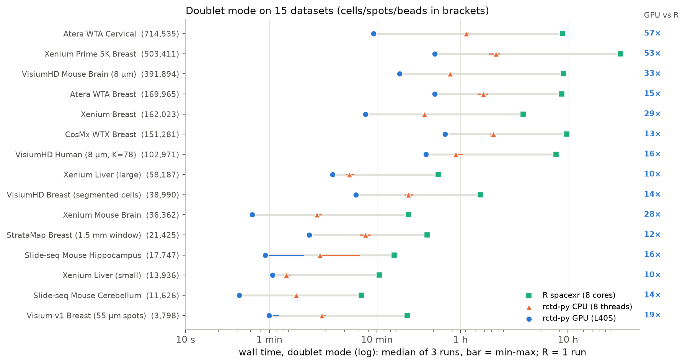

# Benchmarks

Benchmarked across Xenium panels, Visium HD and whole-transcriptome Atera data over all three
modes. Runs on AMD EPYC 9554 nodes; GPU: NVIDIA RTX PRO 6000 Blackwell (96 GB). CPU rctd-py:
`device="cpu"`, 8 threads. R spacexr: 8 cores. rctd-py timings use a warm `torch.compile` cache
and include sigma estimation.

## Runtime

| Dataset | Cells | K | Mode | R spacexr | rctd-py GPU | GPU vs R |
|---|---|---|---|---|---|---|
| Xenium liver (small) | 13,940 | 45 | full | 5.3 min | 1.4 min | 3.8x |
| | | | doublet | 14.1 min | 1.5 min | 9.4x |
| | | | multi | 6.7 min | 1.6 min | 4.2x |
| Xenium mouse brain | 36,362 | 22 | full | 4.7 min | 0.8 min | 5.9x |
| | | | doublet | 12.4 min | 0.9 min | 13.8x |
| | | | multi | 9.5 min | 1.1 min | 8.6x |
| Xenium liver (large) | 58,191 | 45 | full | 14.3 min | 3.6 min | 4.0x |
| | | | doublet | 51.1 min | 3.7 min | 13.8x |
| | | | multi | 153.3 min | 3.7 min | 41.4x |
| Visium HD mouse brain (8 µm) | 392,580 | 22 | full | - | 1.0 min | - |
| Atera WTA breast (FFPE) | 169,965 | 40 | full / doublet / multi | - | 81.7 / 102.8 / 101.0 min | - |
| Atera WTA cervical (FFPE) | 714,535 | 7 | full / doublet / multi | - | 3.5 / 10.2 / 10.3 min | - |

The GPU advantage is largest in doublet mode and in multi mode on large datasets, where R fits
pairs and greedy selections one pixel at a time and rctd-py batches them into tensor operations.
It is also largest at low K and high N: at K=40 with about 4,800 informative genes the per-pixel
solve dominates and GPU and CPU times converge.

## Memory

| Dataset | Cells | K | Peak VRAM | Peak RSS |
|---|---|---|---|---|
| Xenium liver (small) | 13,940 | 45 | 2.6 GB | 34 GB |
| Xenium mouse brain | 36,362 | 22 | 2.6 GB | 5 GB |
| Xenium liver (large) | 58,191 | 45 | 2.6 GB | 34 GB |
| Visium HD mouse brain (8 µm) | 392,580 | 22 | 41 GB | 47 GB |
| Atera WTA breast (FFPE) | 169,965 | 40 | 8.3 GB | 43 GB |
| Atera WTA cervical (FFPE) | 714,535 | 7 | 12.3 GB | 110 GB |

Use `batch_size` to trade throughput for lower peak VRAM. For whole-transcriptome data the
spatial count matrix dominates host RAM.
