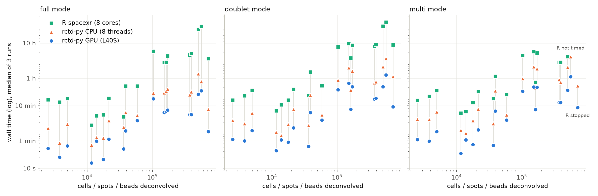

# Benchmarks

rctd-py against R spacexr on 19 datasets from eight platforms (Xenium, Xenium Prime 5K, CosMx,
Atera, Visium v1, v1 FFPE and v2 CytAssist, Visium HD probe-based and 3', Slide-seq and StrataMap),
from 2,518 to 714,535 cells, spots or beads, each run in all three modes.

On one GPU, rctd-py is 10-57x faster than R in doublet mode (median 16x), 5-119x in full mode and
5-21x in multi mode. On 8 CPU threads, without a GPU, it is 3.7-14x faster than R in doublet mode.

## Setup

- **rctd-py GPU**: one NVIDIA L40S (48 GB). **rctd-py CPU**: `device="cpu"`, 8 threads on an AMD
  EPYC 9554. Both use `dtype="float64"`, `batch_size=10000` and `UMI_min=20`.
- **R spacexr** 2.2.1 on R 4.5.0, `max_cores = 8`, `UMI_min = 20`, on the same EPYC 9554 nodes.
- **Timed scope**: everything after the data is loaded. For rctd-py that is
  {class}`~rctd.Reference` plus {func}`~rctd.run_rctd`, sigma estimation included; for R,
  `Reference()`, `SpatialRNA()`, `create.RCTD()` and `run.RCTD()`.
- **Runs**: an untimed warm-up on 2,000 cells fills the `torch.compile` cache, then rctd-py runs three
  times and the tables give the median. R ran once per dataset and mode.
- **Cells** are the pixels fitted: those with at least 20 UMIs, the same filter on both sides.
- **Version**: rctd-py's development code after 0.3.9 (October 2026), before the R-parity changes
  of 0.4.0. On the GPU it runs at the same speed as 0.3.9: the 39 GPU timings that 0.3.9 also has
  (all but the two Slide-seq datasets) are within 6% of 0.3.9's. 0.4.0 adds 5-20 s per run for
  sigma estimation (`N_fit` 1000 instead of 100); its exact box-QP solve costs no measurable time
  (Visium HD K=78, doublet: 1,718 s vs 1,726 s). The four datasets added last (Visium HD 3' mouse
  brain, Visium HD breast 8 µm bins, Visium v2 CytAssist and Visium v1 FFPE breast) were timed with
  the 0.4.0 code.

## Runtime

| Dataset | Platform | Cells | Genes | K | Mode | R spacexr | rctd-py CPU | rctd-py GPU | GPU vs R |
|---|---|---:|---:|---:|---|---:|---:|---:|---:|
| Visium v1 FFPE Breast (55 µm spots) | Visium v1 FFPE | 2,518 | 16,781 | 40 | full | 14.8 min | 2.3 min | 37 s | 24x |
| | | | | | doublet | 14.5 min | 3.8 min | 66 s | 13x |
| | | | | | multi | 14.2 min | 4.1 min | 65 s | 13x |
| Visium v1 Breast (55 µm spots) | Visium v1 | 3,798 | 17,628 | 40 | full | 12.8 min | 53 s | 21 s | 37x |
| | | | | | doublet | 19.1 min | 3.1 min | 60 s | 19x |
| | | | | | multi | 18.5 min | 4.1 min | 59 s | 19x |
| Visium v2 CytAssist Breast (55 µm spots) | Visium v2 CytAssist | 4,992 | 17,215 | 40 | full | 15.9 min | 3.0 min | 44 s | 22x |
| | | | | | doublet | 27.3 min | 6.2 min | 1.9 min | 14x |
| | | | | | multi | 26.9 min | 6.7 min | 1.8 min | 15x |
| Slide-seq Mouse Cerebellum | Slide-seq V2 | 11,626 | 19,915 | 19 | full | 2.8 min | 46 s | 14 s | 12x |
| | | | | | doublet | 7.2 min | 1.8 min | 32 s | 14x |
| | | | | | multi | 6.2 min | 2.0 min | 27 s | 14x |
| Xenium Liver (small) | Xenium (custom panel) | 13,936 | 376 | 45 | full | 5.1 min | 76 s | 59 s | 5x |
| | | | | | doublet | 10.6 min | 86 s | 64 s | 10x |
| | | | | | multi | 6.9 min | 1.7 min | 64 s | 6x |
| Slide-seq Mouse Hippocampus | Slide-seq V2 | 17,747 | 22,594 | 17 | full | 5.5 min | 73 s | 18 s | 18x |
| | | | | | doublet | 14.5 min | 3.0 min | 55 s | 16x |
| | | | | | multi | 12.2 min | 3.8 min | 47 s | 16x |
| StrataMap Breast (1.5 mm window) | Illumina StrataMap | 21,425 | 16,016 | 40 | full | 16.4 min | 3.8 min | 67 s | 15x |
| | | | | | doublet | 29.4 min | 7.8 min | 2.4 min | 12x |
| | | | | | multi | 25.1 min | 8.0 min | 2.1 min | 12x |
| Xenium Mouse Brain | Xenium (248-plex) | 36,362 | 242 | 22 | full | 4.9 min | 2.5 min | 36 s | 8x |
| | | | | | doublet | 19.6 min | 2.8 min | 42 s | 28x |
| | | | | | multi | 16.0 min | 3.1 min | 45 s | 21x |
| VisiumHD Breast (segmented cells) | Visium HD | 38,990 | 17,585 | 40 | full | 36.4 min | 6.5 min | 1.9 min | 19x |
| | | | | | doublet | 1.5 h | 19.6 min | 6.4 min | 14x |
| | | | | | multi | 68.9 min | 26.5 min | 7.1 min | 10x |
| Xenium Liver (large) | Xenium (custom panel) | 58,187 | 376 | 45 | full | 36.5 min | 5.3 min | 3.7 min | 10x |
| | | | | | doublet | 37.1 min | 5.5 min | 3.9 min | 10x |
| | | | | | multi | 20.9 min | 5.5 min | 3.9 min | 5x |
| VisiumHD Human (8 µm, K=78) | Visium HD | 102,971 | 16,207 | 78 | full | 6.0 h | 22.8 min | 15.7 min | 23x |
| | | | | | doublet | 7.8 h | 54.0 min | 28.6 min | 16x |
| | | | | | multi | 4.5 h | 59.3 min | 25.6 min | 11x |
| CosMx WTX Breast | CosMx (19k WTX) | 151,281 | 17,780 | 40 | full | 2.8 h | 23.5 min | 6.4 min | 26x |
| | | | | | doublet | 9.7 h | 2.0 h | 43.2 min | 13x |
| | | | | | multi | 5.7 h | 2.2 h | 33.9 min | 10x |
| Xenium Breast | Xenium (313-plex) | 162,023 | 304 | 40 | full | 2.9 h | 26.3 min | 7.0 min | 24x |
| | | | | | doublet | 3.8 h | 27.8 min | 7.9 min | 29x |
| | | | | | multi | 46.6 min | 32.4 min | 7.7 min | 6x |
| Atera WTA Breast | Atera (18k WTA) | 169,965 | 17,949 | 40 | full | 4.3 h | 29.8 min | 7.6 min | 34x |
| | | | | | doublet | 8.7 h | 1.6 h | 34.6 min | 15x |
| | | | | | multi | 5.3 h | 1.9 h | 33.3 min | 10x |
| VisiumHD 3' Mouse Brain (8 µm) | Visium HD 3' (poly-A) | 371,461 | 19,327 | 22 | full | 4.7 h | 20.3 min | 5.6 min | 50x |
| | | | | | doublet | 8.1 h | 45.0 min | 15.5 min | 31x |
| | | | | | multi | 2.9 h | 55.3 min | 12.3 min | 14x |
| VisiumHD Mouse Brain (8 µm) | Visium HD | 391,894 | 15,331 | 22 | full | 5.1 h | 25.1 min | 5.6 min | 55x |
| | | | | | doublet | 9.0 h | 48.0 min | 16.3 min | 33x |
| | | | | | multi | 2.9 h | 46.6 min | 12.4 min | 14x |
| Xenium Prime 5K Breast | Xenium Prime 5K | 503,411 | 4,929 | 40 | full | 24.6 h | 80.7 min | 21.3 min | 69x |
| | | | | | doublet | 30.7 h | 2.1 h | 34.5 min | 53x |
| | | | | | multi | 4.1 h | 2.1 h | 27.4 min | 9x |
| VisiumHD Breast (8 µm bins) | Visium HD | 557,300 | 17,585 | 40 | full | 30.2 h | 48.5 min | 26.5 min | 68x |
| | | | | | doublet | 40.0 h | 3.7 h | 74.2 min | 32x |
| | | | | | multi | not timed (2) | 4.1 h | 66.2 min | - |
| Atera WTA Cervical | Atera (18k WTA) | 714,535 | 17,949 | 7 | full | 3.6 h | 7.9 min | 1.8 min | 119x |
| | | | | | doublet | 8.9 h | 67.6 min | 9.4 min | 57x |
| | | | | | multi | stopped (1) | 37.0 min | 8.9 min | - |

The largest gains are on the largest datasets: 31-57x in doublet mode on the five above 300,000 cells.
The GPU's lead over rctd-py on CPU is smallest on the two Xenium liver datasets (376 genes, 45 cell
types: 1.3-1.5x) and on Visium HD with 78 cell types (1.4-2.3x); on the other 16 datasets it is
1.8-7.2x.

(1) R's multi mode stopped after 3.2 hours with `process_bead_multi: no cell types passed weight
threshold on full mode`: when one pixel has no candidate type, R ends the whole run. rctd-py keeps
that pixel's highest-weight type and finishes (see {doc}`r_spacexr`).

(2) Not timed. R's full and doublet runs on this dataset took 30 and 40 hours.

## Memory

| Dataset | Cells | K | Peak VRAM | Peak RAM (GPU run) | Peak RAM (CPU run) |
|---|---:|---:|---:|---:|---:|
| Visium v1 FFPE Breast (55 µm spots) | 2,518 | 40 | 9.3 GiB | 3.6 GiB | 10 GiB |
| Visium v1 Breast (55 µm spots) | 3,798 | 40 | 9.5 GiB | 4.1 GiB | 11 GiB |
| Visium v2 CytAssist Breast (55 µm spots) | 4,992 | 40 | 9.5 GiB | 4.6 GiB | 11 GiB |
| Slide-seq Mouse Cerebellum | 11,626 | 19 | 7.2 GiB | 6.0 GiB | 8.2 GiB |
| Xenium Liver (small) | 13,936 | 45 | 5.3 GiB | 5.0 GiB | 4.6 GiB |
| Slide-seq Mouse Hippocampus | 17,747 | 17 | 7.7 GiB | 6.6 GiB | 8.3 GiB |
| StrataMap Breast (1.5 mm window) | 21,425 | 40 | 9.6 GiB | 8.1 GiB | 12 GiB |
| Xenium Mouse Brain | 36,362 | 22 | 5.3 GiB | 3.9 GiB | 4.1 GiB |
| VisiumHD Breast (segmented cells) | 38,990 | 40 | 11 GiB | 13 GiB | 14 GiB |
| Xenium Liver (large) | 58,187 | 45 | 5.3 GiB | 5.1 GiB | 4.9 GiB |
| VisiumHD Human (8 µm, K=78) | 102,971 | 78 | 12 GiB | 25 GiB | 25 GiB |
| CosMx WTX Breast | 151,281 | 40 | 15 GiB | 40 GiB | 40 GiB |
| Xenium Breast | 162,023 | 40 | 5.6 GiB | 4.6 GiB | 12 GiB |
| Atera WTA Breast | 169,965 | 40 | 16 GiB | 45 GiB | 45 GiB |
| VisiumHD 3' Mouse Brain (8 µm) | 371,461 | 22 | 14 GiB | 67 GiB | 68 GiB |
| VisiumHD Mouse Brain (8 µm) | 391,894 | 22 | 14 GiB | 64 GiB | 64 GiB |
| Xenium Prime 5K Breast | 503,411 | 40 | 13 GiB | 41 GiB | 42 GiB |
| VisiumHD Breast (8 µm bins) | 557,300 | 40 | 29 GiB | 134 GiB | 136 GiB |
| Atera WTA Cervical | 714,535 | 7 | 16 GiB | 112 GiB | 113 GiB |

Peak VRAM is the most PyTorch allocated in any of the three runs, over all modes. With
`batch_size` fixed it depends mostly on the genes and cell types, but it still rises with the
number of pixels on large whole-transcriptome datasets. On the small Xenium panels (242-376
genes) the peak comes from multi mode; full and doublet mode stay under 1 GiB there. Lower
`batch_size` to reduce it, or use `dtype="float32"`, which roughly halves it (0.50-0.62x in
doublet mode on whole-transcriptome data). Peak RAM is the whole Python process, including reading the `.h5ad` files.
